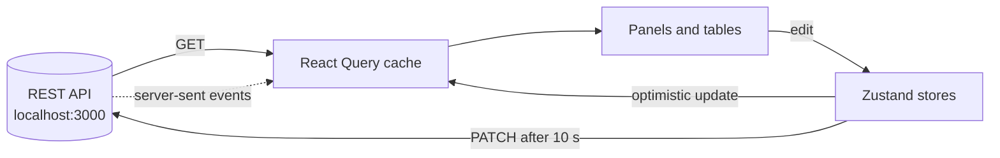

# Architecture

This page explains how the application is assembled, how pages are composed, and how the source code is organised.

**On this page**

- [Application shell](#application-shell)
- [Routing](#routing)
- [Page composition](#page-composition)
- [Folder structure](#folder-structure)
- [Anatomy of a feature](#anatomy-of-a-feature)
- [Data flow at a glance](#data-flow-at-a-glance)
- [Styling](#styling)

## Application shell

The app starts in `src/main.tsx`, which renders `App` inside React `StrictMode` and the theme provider. `App` (`src/App.tsx`) then adds data caching, routing and the always-visible interface.

```text
StrictMode
└── AppThemeProvider            MUI light/dark theme and CssBaseline
    └── App
        ├── PersistQueryClientProvider   React Query client with localStorage persistence
        │   └── BrowserRouter
        │       ├── OfflineBanner        offline message
        │       ├── Header (NavBar)      logo, navigation, user menu, theme toggle
        │       ├── NotificationDrawer   side drawer
        │       ├── SnackbarComponent    messages with an Undo action
        │       └── Routes               the current page
        └── ReactQueryDevtools           open by default
```

!!! tip "Developer tools"
    React Query Devtools are rendered with `initialIsOpen={true}`, so the panel opens automatically in development. Change this value in `App.tsx` if you prefer it closed.

## Routing

Routing uses React Router (`BrowserRouter`). Two routes are defined.

| Path | Component | Page |
|---|---|---|
| `/home` | `MainBody` | Products dashboard |
| `/customers` | `UsersMainBody` | Customers dashboard |

The navigation bar lists Home, Products, Orders, Customers, Reports and Settings, and builds each link from the label (for example `/orders`). Only `/home` and `/customers` have matching routes, so the other links, and the root path `/`, currently render no page content.

## Page composition

Each page is a grid of independent **panels**. Every panel is loaded lazily with `React.lazy` and wrapped in `ErrorSuspenceWrapper` (`components/common/wrapper.tsx`), which combines two protections:

- A **Suspense** boundary shows a `Loading` placeholder while the panel's code downloads.
- An **error boundary** catches rendering errors and shows "*panel name* failed to load", so one failing panel does not break the page.

### Home page panels

| Panel | Component | Layout |
|---|---|---|
| Summary | `feature/summary/Summary` | One column on small screens, half width from the `md` breakpoint |
| Alerts | `AlertsPanel` | Same as Summary |
| Product Table | `feature/products/ProductTable` | Full width from the `md` breakpoint |
| Products Chart | `ProductsChart` | Full width from the `md` breakpoint |

The home page is configured by a `panels` array in `components/main/body.tsx`. To add a panel, add an entry with a name, a lazy component and optional column-span and minimum-height settings.

The Customers page (`components/users/body.tsx`) uses the same pattern with Summary, Alerts, a customers table and the shared Products Chart.

## Folder structure

```text
src/
├── main.tsx, App.tsx          entry point and application shell
├── components/
│   ├── common/                shared building blocks (wrappers, dialogs, skeletons, notifications)
│   ├── feature/
│   │   ├── products/          the products feature (see below)
│   │   └── summary/           summary cards for the home page
│   ├── layout/                header, navigation, notification drawer
│   ├── main/                  home page composition
│   └── users/                 customers page and its panels
├── store/                     Zustand store and slices shared across the app
├── theme/                     MUI light and dark themes, theme context, toggle
├── context/                   React context (product categories)
├── types/                     shared TypeScript types
└── mock/                      sample data from early development (not imported by the app)
```

The `components/common` folder holds code that more than one feature uses. Code that belongs to one feature stays inside that feature's folder.

## Anatomy of a feature

The products feature (`components/feature/products/`) shows the intended pattern:

```text
products/
├── ProductTable.tsx           the feature's entry component
├── components/
│   ├── DataGrid.tsx           grid rendering, loading and error states
│   └── EditTable/             single and multiple product edit forms
├── hooks/                     data fetching, mutations, dialog logic, grid columns
├── store/                     the feature's Zustand store
├── types/                     feature-specific types
└── utils/                     helper functions
```

Tests sit next to the code they cover (for example `productStore.test.tsx` beside `productStore.tsx`).

## Data flow at a glance



Server data lives in the React Query cache and the interface reads from it. Edits first update the cache optimistically and are sent to the server after the undo window. See [State management](state-management.md) for the details.

## Styling

Components and theming come from MUI. The theme (`src/theme/index.ts`) defines light and dark modes and adds a custom `brand` palette (`main`, `soft`, `success`, `info`, `warning`, `error`) used for accents. Tailwind CSS utility classes, enabled through the `@tailwindcss/vite` plugin, handle page layout such as the panel grid.
